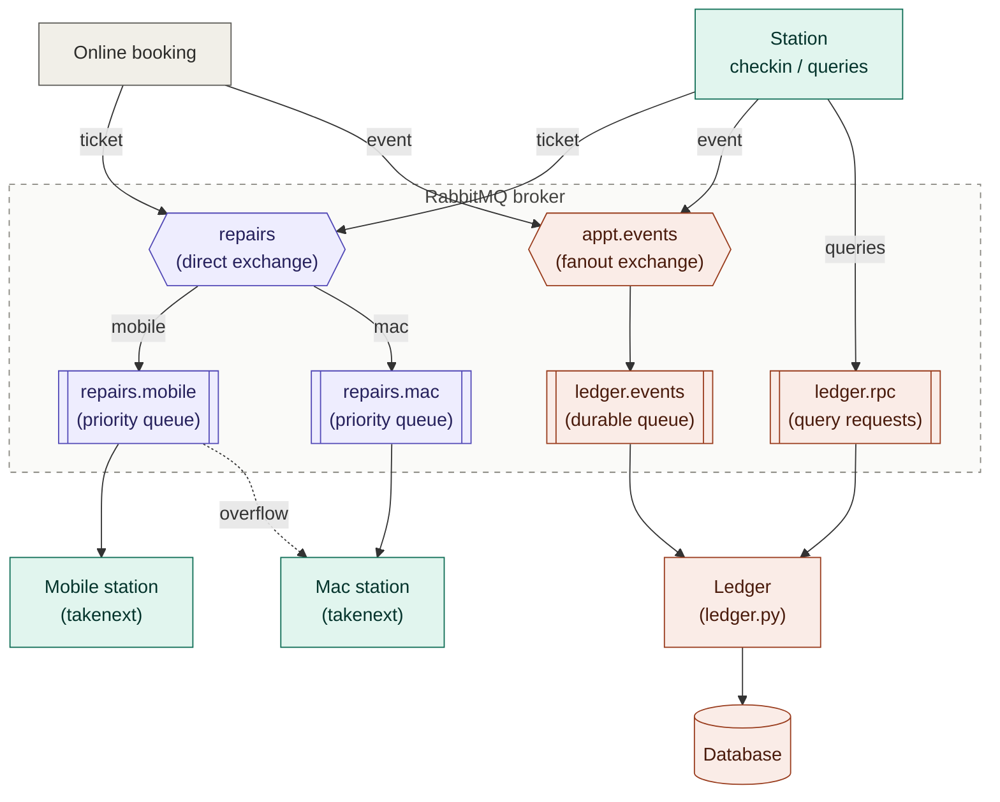

# Dragonfly: Distributed Repair Queue.

Outside of school, I work as a Genius Admin at Apple. Part of my job is to manage the repair/technical support queue.
Throughout this course, I have tried to look at the tools I use in my day-to-day life and see whether they could be considered distributed systems.
One easy correlation was with work. In the system that we use, customers get checked into a central queue, All technicians see and take from the same queue.
I thought it could be interesting (and applicable) to try recreating this queue as my distributed systems assignment.

## How / Why is this distributed?
- **1. There are many independent producers.** Each technician / check-in person (and online booking) can create appointments at the same time. 
This system does not rely on a central server to generate/distributed IDs. It is up to each node to generates unique IDs that can't collide.
- **2. There are many competing workers.** Similar to my work queue, technicians on different machines/instances all pull from the same queues.
RabbitMQ guarantees each appointment goes to exactly one station.
- **3. Fault tolerance!** A station holds an appointmnet *unacknowledged* until it is ended. If its
  process or computer dies, the system puts the appointment back in the queue and the next time a technician requests an appointment, the appointment gets marked as reassigned.
- **4. Record keeping.** Every state change is broadcasted as an event. The system records/saves them in SQLite. Events wait in a durable queue, so events sent while the ledger is down are still available to consume when it restarts.

## Stations / roles
For simplicity, there is only one kind of 'station' (in the sense that, technically, everyone can both create and start appointments). \
`--role` only decides which queue(s) a technician pulls from: \
• `mobile` will pull only from the `repairs.mobile` queue (any apple product outside of macs falls here). \
• `mac` will prioritize `repairs.mac` (mac/apple computer appointments), if empty though, it can pull from `repairs.mobile`. 


## Architecture


## Requirements
- Python
- Docker Desktop on the host computer
- Pika

## Running on one computer

```bash
# 1. Start RabbitMQ
docker compose up -d
# Management UI: http://localhost:15672  (user: dragonfly / pass: dragonfly)

# 2. Install the Python client
python3 -m venv .venv && source .venv/bin/activate     # Windows: .venv\Scripts\activate
pip install pika

# 3. Open separate terminals for each node
python ledger.py
python station.py --name Desk1 --role mobile
python station.py --name Alex  --role mac    
python station.py --name Sam   --role mobile 
python online_booking.py                         
```

## Running across several computers on the same network

One computer runs RabbitMQ. The other computer(s) point nodes at it.

**On the host computer:**
1. `docker compose up -d`
2. Find its LAN IP address:
   - macOS: `ipconfig getifaddr en0`
   - Windows: `ipconfig` (IPv4 Address)
   - Linux: `hostname -I`

**On other computer(s):**
```bash
pip install pika
export RABBIT_HOST=<BROKER_IP> #Windows PowerShell: $env:RABBIT_HOST="192.168.1.42"
python station.py --name Sam --role mobile
#   ...or pass it directly: python station.py --name Sam --role mobile --host 192.168.1.42
```
NOTE:
- Any node, including the ledger, can run on any computer. 
- Run **ONLY one** `ledger.py`.


## Commands
Each station has the ability to run the following commands:

• `checkin` - Prompts for customer, device, issue, express (y/n), and queues the appointment \
• `takenext` - Take the next appointment for your role (prioritizes express appointments) \
• `writenotes "text"` - Append a note to your current appointment \
• `endappt` - Finish your current appointment \
• `release` -  Put your current appointment back in the queue \
• `current` - Details and notes for your current appointment \
• `myappts` - List appointments you've taken today \
• `allappts` - List all appointments today \
• `show <id>` - Full details and notes for one appointment \
• `queues` - How many appointments are waiting in each queue \
• `help`, `quit` 

## AI Disclosure
In 2026, it is hard to find code that is not AI-assisted in some way, shape or form. \
With that being said, parts of this code was/were assisted and/or generated with AI. \
Of course, the code that was generated has been labeled and reviewed (and understood) by me.
